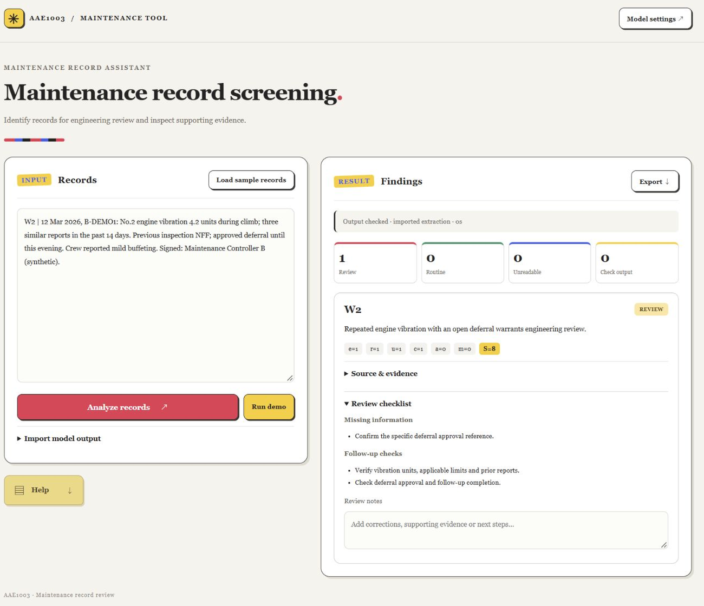

# AMRA — Aircraft Maintenance Record Assistant

An AI-driven early-warning assistant for aircraft maintenance record screening.

**[Website](https://www.amratool.online)** · **[Try the prepared demo](https://www.amratool.online/workbench?demo=1)**

AMRA combines language-model extraction, local evidence checks and screening rules, and human review. Users provide current maintenance records and related history, inspect source quotations, add review notes and export the results.

## Quick start

Requires **Python 3.10+**. The local workbench uses Python's standard library.

```bash
git clone https://github.com/PalestyHR/AMRA.git
cd AMRA
python app.py
```

The browser opens at `http://127.0.0.1:8765/`. Select **Open workbench** to enter the tool. On Windows, `Run_AMRA.cmd` starts the same program.

To select another port:

```bash
python app.py --no-browser --port 18765
```

### Try the examples

1. Choose **Load sample records**.
2. Choose **Run demo** to process prepared extractions through the local checks.
3. Expand **Source & evidence** and **Review checklist**.
4. Add review notes and choose **Export** to download the JSON record.

Demo mode requires no API key. Live extraction uses the endpoint, model name and API key supplied in **Model settings**. The key is kept in memory during the session and excluded from review exports.



### Use your own records

Separate entries with a blank line. A unique identifier can precede each entry:

```text
R01 | Aircraft TEST-A. Cabin reading light inoperative. Bulb replaced; functional test satisfactory. Work complete and signed.

R02 | Aircraft TEST-B. The same pump failed again after two previous similar entries. Rectification deferred with approval.
```

Include related history in date order, together with aircraft and component identifiers. The interface also accepts a saved extraction through **Import model output**.

## Screening workflow

The language model extracts six evidence fields: abnormal symptoms, recurrence, unresolved or deferred work, critical-system impact, ambiguity, and missing information. It also supplies source quotations and review checks.

Local software checks record coverage, binary fields and quotation matches, then applies the project rule:

```text
S = 2e + 2r + 2u + 2c + a
REVIEW  when S >= 4 or m = 1
ROUTINE otherwise
```

Unreadable input enters **INSUFFICIENT INFORMATION** and source recovery. Output-check failures receive **CHECK OUTPUT** with the detected issue. Reviewers inspect the evidence and record follow-up decisions.

The extraction prompt is defined in `app.py` as `PROMPT`; the current prompt version is `gui-1`.

## Tests

```bash
python -m unittest -v test_app
```

The 14 core tests cover parsing, scoring, record coverage, quotation checks and mocked API handling.

For the optional hosted wrapper:

```bash
python -m pip install -r requirements-hosted.txt
python -m unittest -v test_app test_hosted
```

The combined suite contains 22 tests and makes no live model calls.

## Optional hosted entry point

```bash
python -m pip install -r requirements-hosted.txt
python hosted.py
```

`AMRA_BIND`, `AMRA_PORT`, `AMRA_API_BASE_URL` and `AMRA_MODEL` configure the hosted service. HTTPS and the public domain are configured by the hosting environment.

## Files

| File | Purpose |
| --- | --- |
| `app.py` | Local HTTP server, extraction prompt, evidence checks and screening rules |
| `hosted.py` | Optional WSGI/Waitress entry point sharing the same core |
| `index.html`, `app.js`, `style.css` | Review workbench |
| `landing.html`, `landing.js`, `landing.css` | Project homepage and globe animation |
| `demo.json` | Synthetic records and prepared extractions |
| `test_app.py`, `test_hosted.py` | Core and hosted tests |
| `assets/` | Local fonts, logo assets and coastline geometry |

## Project and credits

Developed for **AAE1003, Topic 9 Team**, The Hong Kong Polytechnic University.

GUI, website, logo design, interaction design and deployment: **He Youbin**.

GenAI supported implementation, visual development and revision. The group report describes the contributions and verification records. Font licences and asset sources are retained in `assets/`.
